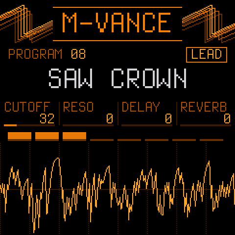

<p align="center"></p>

# M-vance

**A JP-8000/8080-style virtual analog for the M-VAVE FM-1: the JT-8000 synth engine, ported to the FM-1.**

M-vance is open-source firmware for the M-VAVE FM-1. It is the FM-1 edition of the **JT-8000**, a JP-8000-style synth
for the Teensy 4.1: its floating-point DSP rewritten in C99 fixed point for the FM-1's chip (no FPU), with the JP's
laws (envelope times, LFO rates, modulation depths, the filter's cutoff and resonance) measured against the JP-8000's
own firmware running in the JE-8086 emulator. Super Saw, the JP filter, the multi-effects, delay, a plate reverb, an
arpeggiator, a two-track sequencer and 64 programs, on eight voices.

<p align="center"></p>

- **Web page:** <https://bk40-home.github.io/M-vance/> (from `docs/`)
- **Cheat sheet:** [docs/cheatsheet.html](docs/cheatsheet.html): two A4 pages to print and keep by the FM-1

> **Status: in development, not yet released.** Builds are tested on the FM-1 as they go; the first release will be
> on [Releases](https://github.com/bk40-home/M-vance/releases) and, once listed, on the
> [FM-1 Firmware Hub](https://thefirmwarehub.com). Package identity `FM-1_960`.

## The synth

| | |
| --- | --- |
| **Voices** | 8. POLY, MONO (last note, LEGATO), UNISON (every voice on one note, DETUNE), PORTAMENTO in every mode. A VOICES limit (GLOBAL). |
| **OSC 1** | SUPER SAW, TRIANGLE MOD, NOISE, FEEDBACK OSC, SQUARE, SAW, TRIANGLE. CTRL 1 and CTRL 2 change job with the wave, as on the JP. |
| **OSC 2** | SQUARE, SAW, TRIANGLE, NOISE. SYNC to OSC 1, RANGE ±25 semitones with the WIDE ends, FINE. |
| **Common** | RING, X-MOD, BALANCE, OSC SHIFT. PITCH ENV: attack, decay, depth up to ±4 octaves. |
| **Filter** | The JP filter: LPF, BPF, HPF at −12 or −24 dB, RESONANCE, KEY FOLLOW, LFO 1 / LFO 2 depths, FILTER ENV (ADSR). |
| **Amp** | AMP ENV (ADSR), LEVEL, tremolo from either LFO, AUTO PAN or a fixed pan position. |
| **LFOs** | LFO 1: triangle, saw, square, random, with FADE. LFO 2: triangle, brought in by the mod wheel. |
| **Effects** | TONE (bass, treble), MULTI-FX (super chorus, flanger, phaser, twist, freeze, DISTORTION), DELAY (five stereo patterns, as a send), a stereo plate REVERB (global), a look-ahead limiter on the output. |
| **Arpeggiator** | [Skiff](https://github.com/illuminus5/skiff)'s: 14 modes, 1/4 to 4 bars with triplets, 1–4 octaves, gate, swing, chance, HOLD (latch), note order. Its own tempo, or MIDI clock. |
| **Layer / split** | Every program is a performance, as on the JP: an UPPER and a LOWER patch, played SINGLE, DUAL (both on every key) or SPLIT (LOWER below the split key: set it by touching SPLIT and pressing a key). The 8 voices are cut between them (1+7 .. 7+1), BALANCE between them, each its own MIDI channel if wanted, and the arp on either part or both (a split's left hand arpeggiates under the right). PANEL picks the part the pages edit. From the JT-8000's performance. |
| **Sequencer** | Two tracks, LOWER and UPPER, recorded in real time, each playing its own part (a split's bass line under a live right hand). 1, 2, 4 or 8 bars per track, QUANT (1/16, 1/8 and triplets), overdub, MUTE, CLEAR. PLAY and REC on the panel, or MIDI START / STOP, locked to the clock. TRANSPOSE: the keys move a playing track (from its first note). A piano roll shows each track, a bar at a time. Up to 128 notes a track; 12 named clips in flash, saved from and loaded into either track. |
| **Programs** | 64 in flash: 16 leads, 12 pads, 12 basses, 8 plucks and arps, 8 brass, strings and bells, 8 effects (16 is a SPLIT, 28 a DUAL). SAVE: write (rename, copy to another slot), swap (reorder), back to the factory sound. A `*` by the name: edited, not saved. |
| **MIDI** | USB-MIDI in and out, the TRS MIDI IN. Notes, program change, pitch bend (BEND + / − per program), mod wheel, clock and START. Every knob sends and receives the JP-8080's MODE2 CC. |

Integers only: the chip has no FPU. Tables are generated by `tools/gen_tables.py` (and `gen_rv_tables.py`,
`gen_params.py`) and committed.

## The panel

The JP-8080's sections are pages on the FM-1's screen. A section button opens its first page, again the next (it
loops); KNOB 1–4 edit the four columns, left to right; SELECT steps the knob touched last; ALGORITHM walks every page;
PRESETS picks the program; HOME goes home. On HOME the four knobs are CUTOFF, RESO, DELAY (the send) and REVERB (the
global level), over a voice strip and a scope of the output.

| Button | Pages |
| --- | --- |
| **LFO** | LFO 1/2 (WAVE, RATE 1, FADE, DEST), LFO 2/2 (RATE 2, DEPTH SELECT, pitch LFO 1, pitch LFO 2) |
| **EDIT** | OSC 1, OSC 2 (2 pages), OSC COMMON |
| **ENV** | PITCH ENV, FILTER ENV, AMP ENV |
| **SEL** | FILTER (2 pages), AMP |
| **FX** | TONE, MULTI-FX, DELAY, REVERB (2 pages, global) |
| **GLO** | PLAY MODE (2 pages), PERFORM (2 pages: MODE, SPLIT, BALANCE, PANEL / VOICES, ARP, CH LO, CH UP), GLOBAL (MIDI CH, VOICES, TEMPO), DEBUG (CPU average and 3 s peak, voices, octave, MIDI channel, notes in, clock, firmware version: off every other screen) |
| **ARP** | tap: the arp on / off; hold 0.5 s: ARP (2 pages, global) |
| **SEQ** | 1/3: LENGTH (the selected track's), QUANT, MUTE L, MUTE U (global); 2/3: the piano roll, with BAR, PITCH, TRANSPOSE and ROOT; 3/3: the clips (CLIP, CURSOR, CHAR, MODE LOAD / SAVE: SAVE does it). **PLAY**: the sequencer on / off. **REC**: tap, arm the selected track; hold 1 s, clear it |
| **OCT- + OCT+** | hold one, press the other: PART SELECT (OCT- LOWER, OCT+ UPPER, both BOTH): the part the pages, the knobs and REC act on |
| **SAVE** | its page: TO, CURSOR, CHAR, MODE (WRITE / SWAP / FACTORY); SAVE again does it |

Every knob, range and choice: the [cheat sheet](docs/cheatsheet.html). It is generated from the firmware's own page
table (`tests/run_docs.sh`), so it shows the panel exactly as the build has it.

## Install

- **The FM-1 Firmware Hub** (once listed): [thefirmwarehub.com](https://thefirmwarehub.com) in Chrome or Edge, the FM-1
  on USB, pick M-vance. Going back to another firmware, or the official one, works the same way.
- **From the command line:** `python3 tools/fm1_install.py mvance-X.Y.fwsc` (from a release, or your own build).
- **If it won't start:** hold **OCT-** while switching on: the USB rescue, no sound, only the updater. Install a
  working build (or another firmware from the hub) from there. Installing firmware is at your own risk.

## Build and run

M-vance is built on [Dinghy](https://github.com/zvenson/dinghy) and keeps its platform (boot, USB, updates, audio,
storage) unchanged. You need Linux on x86-64 (or Windows with WSL, macOS with Docker), Python 3 with Pillow, the JieLi
toolchain and three files of the JieLi AC79 SDK:

```sh
pip3 install Pillow mido python-rtmidi
tools/get_toolchain.sh                      # JieLi's clang for the chip, to ~/.jieli/toolchain
git clone --depth 1 --branch AC79NN_SDK_V1.2.1_2023-12-13 \
    https://gitee.com/Jieli-Tech/fw-AC79_AIoT_SDK.git ~/fw-AC79_AIoT_SDK
```

Then:

```sh
sh tests/run_unit.sh                        # the engine's unit tests
tests/run_host.sh [script]                  # the firmware on your computer: build/host/mvance.wav and the screens
sh tests/run_docs.sh                        # the cheat sheet and the web page's screens, from the firmware
./build.sh                                  # build/mvance.fwsc (refuses what would brick an FM-1)
./build.sh --release 0.1                    # build/mvance-0.1.fwsc, the version on the screen
python3 tools/fm1_install.py build/mvance.fwsc
```

The factory bank is a list, `tools/bank/factory.txt`: a source bank and patch per slot, its name and its edits.
`python3 tools/make_bank.py` turns it into `build/mvance-factory.syx` (a JP-8080 SysEx bank) and
`firmware/gen/mv_factory.h`; rebuild the firmware after. `python3 tools/make_bank.py --auto` instead takes every
`.mid` / `.syx` in `docs/presets/`: it writes `tools/bank/auto.txt` (64 programs in the same groups, the files taking
turns, layered performances whole, duplicates and empty init patches left out) and builds the bank from it. A program can also be designed from scratch: `INIT` as its source (the JP init
patch) and its edits naming choices (`OSC1_WAVE=SUPERSAW FLT_TYPE=BPF MONO=ON`; `tools/make_bank.py` says how).
`python3 tools/audition.py` plays every program on the host build to
`build/audition/NN_name.wav` with its level, to hear a bank before flashing it (Linux / macOS / WSL).

Programs saved on an FM-1 belong to the bank they were saved from. A firmware with a different factory bank
asks at power-on: **SAVE** loads the new bank (all 64 replaced, your saves with them), **HOME** keeps your
programs (it does not ask again until the next new bank). SAVE's FACTORY mode brings back one slot.

**Programs to and from a computer:** [docs/bank.html](docs/bank.html) (Chrome or Edge, WebMIDI; open it from GitHub
Pages, or run `python -m http.server` in `docs/` and open `http://localhost:8000/bank.html`). Open a `.mid` or `.syx`
of JP-8000/8080 SysEx: **Play** auditions a patch or performance on the FM-1 without saving it, **Send ticked to
slots** writes the ticked ones into the slots from the one you choose (one ticked: one targeted slot), **Read all 64**
reads the FM-1's programs back and **Download .syx** saves them. `python3 tools/make_bank.py --from-device FILE.syx`
then makes those the factory bank: the file is kept as `tools/bank/device.syx`, `factory.txt` takes every slot from it
(each line's comment says where the program came from; the old list goes to `tools/bank/history/`), and the bank is
built. USB only (the TRS jack has no SysEx). The protocol, JP-8080 DT1 / RQ1 with one M-vance area for the
performance bytes: `firmware/src/mv_xfer.h`; `python3 tests/xfer_test.py` checks it on the host build.

`tests/scripts/*.txt` are host scripts (keys, buttons, knobs, MIDI over time; `tests/host.c` says what a line can
do). The compare tools in `tools/compare/` (`run_compare.sh`) run the fixed-point code next to the JT-8000's float code.
The chip's rules: [docs/RULES.md](docs/RULES.md); the platform's calls: [docs/API.md](docs/API.md); the SMK-37 build
(not yet tested with M-vance): [docs/SMK37.md](docs/SMK37.md).

## Credits and licence

GPL-3.0-only, see [LICENSE](LICENSE) and [LICENSING.md](LICENSING.md) for who made what. M-vance (the engine, the
panel, the programs, the tools and tests in `firmware/src/mv_*`, `tools/gen_*`, `tools/compare/`) is by Kris
(bk40-home), ported from his JT-8000. It stands on [Dinghy](https://github.com/zvenson/dinghy) (zvenson), which carries
the FM-1 platform of [Felucca](https://github.com/hugelton/Felucca) by Leo Kuroshita (Hügelton Instruments) with the
changes of [SLOOP](https://github.com/isod89/sloop-fm1) (isod89); the arpeggiator is
[Skiff](https://github.com/illuminus5/skiff)'s (illuminus5).

JP-8000 and JP-8080 are trademarks of Roland Corporation; "M-VAVE" and "FM-1" belong to their owners. M-vance is not
made by, endorsed by or affiliated with them, and none of these marks appear in the firmware.
