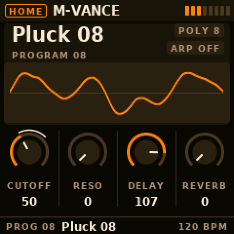

<p align="center"></p>

# JT-80x0

**A JP-8000/8080-style virtual analog for the M-VAVE FM-1: the JT-8000 synth engine, ported to the FM-1.**

*Formerly M-vance (renamed 23 Nov 2026). The repository, its web addresses and the Firmware Hub identity
FM-1_968080 are unchanged, so an FM-1 running M-vance takes JT-80x0 as an ordinary update and keeps its programs.*

JT-80x0 is open-source firmware for the M-VAVE FM-1. It is the FM-1 edition of the **JT-8000**, a JP-8000-style synth
for the Teensy 4.1: its floating-point DSP rewritten in C99 fixed point for the FM-1's chip (no FPU), with the JP's
laws (envelope times, LFO rates, modulation depths, the filter's cutoff and resonance) measured against the JP-8000's
own firmware running in the JE-8086 emulator. Super Saw, the JP filter, the multi-effects, delay, a plate reverb, an
arpeggiator, a two-track sequencer and 64 programs, on eight voices.

<p align="center"></p>

- **Web page:** <https://bk40-home.github.io/M-vance/> (from `docs/`, published by `.github/workflows/pages.yml`)
- **Cheat sheet:** [docs/cheatsheet.html](docs/cheatsheet.html): two A4 pages to print and keep by the FM-1

> **Status: in development, not yet released.** Builds are tested on the FM-1 as they go; the first release will be
> on [Releases](https://github.com/bk40-home/M-vance/releases) and, once listed, on the
> [FM-1 Firmware Hub](https://thefirmwarehub.com). Package identity `FM-1_96808Y` for release X.Y (v2.2: `FM-1_968082`).

## The synth

| | |
| --- | --- |
| **Voices** | 8. POLY, MONO (last note, LEGATO), UNISON (every voice on one note, DETUNE), PORTAMENTO in every mode. A VOICES limit (GLOBAL). |
| **OSC 1** | SUPER SAW, TRIANGLE MOD, NOISE, FEEDBACK OSC, SQUARE, SAW, TRIANGLE. CTRL 1 and CTRL 2 change job with the wave, as on the JP. |
| **OSC 2** | SQUARE, SAW, TRIANGLE, NOISE. SYNC to OSC 1, RANGE ±25 semitones with the WIDE ends, FINE. |
| **Common** | RING, X-MOD, BALANCE, OSC SHIFT. PITCH ENV: attack, decay, depth up to ±4 octaves. |
| **Filter** | The JP filter: LPF, BPF, HPF at −12 or −24 dB, RESONANCE, KEY FOLLOW, LFO 1 / LFO 2 depths, FILTER ENV (ADSR). |
| **Amp** | AMP ENV (ADSR), LEVEL, tremolo from either LFO, AUTO PAN or a fixed pan position. |
| **LFOs** | LFO 1: triangle, saw, square, random, with FADE. LFO 2: triangle, brought in by the mod wheel. |
| **Effects** | TONE (bass, treble), MULTI-FX (super chorus, flanger, phaser, twist, freeze, DISTORTION), DELAY (five stereo patterns, as a send), a stereo plate REVERB (global), a look-ahead limiter on the output. |
| **Arpeggiator** | [Skiff](https://github.com/illuminus5/skiff)'s: 14 modes, 1/4 to 4 bars with triplets, 1–4 octaves, gate, swing, chance, HOLD (latch), note order. Its own tempo, or MIDI clock. |
| **Layer / split** | Every program is a performance, as on the JP: an UPPER and a LOWER patch, played SINGLE, DUAL (both on every key) or SPLIT (LOWER below the split key: set it by touching SPLIT and pressing a key). The 8 voices are cut between them (1+7 .. 7+1), BALANCE between them, each its own MIDI channel if wanted, and the arp on either part or both (a split's left hand arpeggiates under the right). PANEL picks the part the pages edit. From the JT-8000's performance. |
| **Sequencer** | Two tracks, LOWER and UPPER, recorded in real time, each playing its own part (a split's bass line under a live right hand). 1 to 32 bars per track, QUANT (1/16, 1/8 and triplets), overdub, MUTE, CLEAR. PLAY and REC on the panel, or MIDI START / STOP, locked to the clock. TRANSPOSE: the keys move a playing track (from its first note). A piano roll shows each track, a bar at a time. Up to 128 notes recorded a track; 12 named clips in flash, saved from and loaded into either track. Factory clips (read-only, F1, F2 ..) can be built into your own firmware from MIDI files: `python3 tools/mid2clip.py DIR` (one clip per MIDI track, looped on its shortest exact repeat, else the whole part, up to 32 bars; `tools/clips/clips.txt` overrides a loop; the output stays local). They play straight from flash, with no note limit; one of 128 notes or fewer can be recorded over (it is copied to RAM first). |
| **Programs** | 64 in flash: 16 leads, 12 pads, 12 basses, 8 plucks and arps, 8 brass, strings and bells, 8 effects (16 is a SPLIT, 28 a DUAL). SAVE: write (rename, copy to another slot), swap (reorder), back to the factory sound. A `*` by the name: edited, not saved. |
| **MIDI** | USB-MIDI in and out, the TRS MIDI IN. Notes, program change, pitch bend (BEND + / − per program), mod wheel, clock and START. Every knob sends and receives the JP-8080's MODE2 CC. |

Integers only. The chip has a single-precision FPU, but only one object uses it: fm1-base's key sensing
(`fk_touch_fpu.c`, built apart by `tools/build.py`). Tables are generated by `tools/gen_tables.py` (and `gen_rv_tables.py`,
`gen_params.py`) and committed.

## Bluetooth MIDI

The FM-1 is a Bluetooth MIDI device called **JT-80x0 XXXX**: connect to it from a Mac (Audio MIDI Setup > Bluetooth
Configuration), an iPhone or an iPad (the app's Bluetooth MIDI page). It plays what comes in and sends what USB sends
(keys, knob CCs, program changes), but not the MIDI clock. **BT MIDI** on the GLO walk's MIDI page switches it ON or OFF
and shows **LINKED** while a computer is connected. It is ON from the factory and kept with the settings. One link at a
time, no pairing code. The program transfer and the library page stay on USB. Bluetooth starts at power-on, and the
first second after that is silent while the radio calibrates. The stack is fm1-base's own (no JieLi library):
`third_party/fm1-kit/firmware/fk_ble/README.md`. `./build.sh --no-ble` builds without it (`jt80x0-usb.fwsc`).

## Velocity, pressure and the JP's VELOCITY and CONTROL

The FM-1's own keys can play with velocity and pressure, with no change to the hardware. Everything is on the GLO
walk's **KEYS** page, and kept with the settings:

- **TOUCH** (OFF from the factory): ON reads the keys' velocity (all 27) and pressure (F3 to C5; C#5 to G5 have
  velocity only, that is the hardware). The velocity goes out with the note-ons; the hardest-pressed key goes out as
  channel pressure. **CURVE** and **SENS** (-5 to +5) shape them; 0 is how fm1-base tuned them. The page's graph shows
  the last velocity, CONTROL and each key's pressure, to set them by feel.
- **VELO SW** (OFF from the factory): **PATCH** applies each patch's own VELO SW and its 40 VELOCITY offsets, as a
  JP-8080 does: a parameter moves by its offset x velocity / 127 (velocity 0 none, 127 all of it). A part's LFO rates
  and the FX follow the part's last note. OFF keeps every patch sounding as it always has here (35 of the 64 factory
  programs have VELO SW on with offsets that were never applied while they were voiced).
- **CONTROL**, the JP's morph, is always live: each patch's 40 CONTROL offsets move by CONTROL / 127. CONTROL is the
  keys' pressure (TOUCH ON) or MIDI channel pressure, whichever is harder; a patch with BEND MORPH ON adds the bend's
  upper half. At rest CONTROL is 0, so nothing moves.

Switching TOUCH on or off ends any notes still held. While it is on, a held key's column LEDs are dark for the moments
the key is read. The sensing is Charles Vestal's, from fm1-base: `third_party/fm1-kit/firmware/fk_touch/README.md`. The
SMK-37 build keeps its own velocity; the web simulator and the fm1-dock module have no TOUCH.

## The panel

The JP-8080's sections are pages on the FM-1's screen. A section button opens its first page, again the next (it
loops); KNOB 1–4 edit the four knobs on screen, left to right; SELECT is the TEMPO (while a MIDI clock sets the tempo
it steps the knob touched last instead); ALGORITHM walks every page; PRESETS picks the program (its list shows for
2 s); HOME goes home. On HOME the four knobs are CUTOFF, RESO, DELAY (the send) and REVERB (the global level), under
a scope of the output (the JT-80X0 fan when nothing sounds). The keys light while their note plays (the keys, MIDI,
the arp, the sequencer) and glow while it rings on in its release.

Every screen has the same four bands: a header (the section, the page, a pip a page, the part edited, a cell a
voice), a graph of what the page does (the envelope, the filter's response, the LFO with its running phase, the
echoes, the plate's tail ...), four knob cells, and a footer (program, name, tempo). Seven themes (AMBER, SEA, EMBER,
ICE, ORCHID, CRT, PAPER) on GLOBAL 2/2, and COLOUR BY TYPE (the name's category). The screens are the screen kit
shared with M-Vsynth2 (`firmware/src/mv_kit.*`, `mv_kui.*`); `-DMV_UI_KIT=0` builds the earlier amber panel.

| Button | Pages |
| --- | --- |
| **LFO** | LFO 1/2 (WAVE, RATE 1, FADE, DEST), LFO 2/2 (RATE 2, DEPTH SELECT, pitch LFO 1, pitch LFO 2) |
| **EDIT** | OSC 1, OSC 2 (2 pages), OSC COMMON |
| **ENV** | PITCH ENV, FILTER ENV, AMP ENV |
| **SEL** | FILTER (2 pages), AMP |
| **FX** | TONE, MULTI-FX, DELAY, REVERB (2 pages, global) |
| **GLO** | PLAY MODE (2 pages), PERFORM (2 pages: MODE, SPLIT, BALANCE, PANEL / VOICES, ARP, CH LO, CH UP), GLOBAL (2 pages: MIDI CH, VOICES, TEMPO / THEME, COLOUR), MIDI (LOCAL, CLOCK, CLK OUT, BT MIDI), KEYS (TOUCH, CURVE, SENS, VELO SW), DEBUG (CPU average and 3 s peak, voices, octave, MIDI channel, notes in, clock, firmware version: off every other screen) |
| **ARP** | tap: the arp on / off; hold 0.5 s: ARP (2 pages, global) |
| **SEQ** | 1/3: LENGTH (the selected track's), QUANT, MUTE L, MUTE U (global); 2/3: the piano roll, with BAR, PITCH, TRANSPOSE and ROOT; 3/3: the clips (CLIP, CURSOR, CHAR, MODE LOAD / SAVE: SAVE does it). **PLAY**: the sequencer on / off. **REC**: tap, arm the selected track; hold 1 s, clear it |
| **OCT- + OCT+** | hold one, press the other: PART SELECT (OCT- LOWER, OCT+ UPPER, both BOTH): the part the pages, the knobs, REC and the keys act on. The keys and knob CCs send on that part's channel (CH UP / CH LO, or GLOBAL); BOTH plays as the mode says |
| **SAVE** | its page: TO, CURSOR, CHAR, MODE (WRITE / SWAP / FACTORY); SAVE again does it |

Every knob, range and choice: the [cheat sheet](docs/cheatsheet.html). It is generated from the firmware's own page
table (`tests/run_docs.sh`), so it shows the panel exactly as the build has it.

## Install

- **From the browser:** the site's firmware page (`docs/flash/`, Chrome or Edge on a computer): find the FM-1, install
  the latest release or a `.fwsc` of your own. The same update as `tools/fm1_install.py` (fm1-kit's `web/fm1ota.js`):
  the package is checked first, another model's is refused, and a cut-off install is finished by running it again.
  On Windows close the library, the editor's link and any DAW first: one program at a time on the FM-1's MIDI port.
- **The FM-1 Firmware Hub** (once listed): [thefirmwarehub.com](https://thefirmwarehub.com) in Chrome or Edge, the FM-1
  on USB, pick JT-80x0. Going back to another firmware, or the official one, works the same way.
- **From the command line:** `python3 tools/fm1_install.py jt80x0-X.Y.fwsc` (from a release, or your own build).
- **If it won't start:** hold **OCT-** while switching on: the USB rescue, no sound, only the updater. Install a
  working build (or another firmware from the hub) from there. Installing firmware is at your own risk.

**The site and its traffic.** `.github/workflows/pages.yml` publishes `docs/`, with the latest release's packages and
`firmware/latest.json` (`tools/flash_manifest.py`) beside the firmware page; a tag's release starts it. Page views and
installs are counted with [GoatCounter](https://www.goatcounter.com) (open source, no cookies) at
<https://bk40.goatcounter.com>, shared with M-Vsynth2's site (told apart by path; the repo variable `GOATCOUNTER_URL`
points this site elsewhere). Local copies never count. The firmware page sends `JT-80x0/flash/start/<identity>` (`M-vance/...` before the rename),
`.../done/<identity>` and `.../fail/<reason>`. GitHub's own figures: *Insights > Traffic* and each release's download counts.

## Build and run

JT-80x0 is built on [Dinghy](https://github.com/zvenson/dinghy) and keeps its platform (boot, USB, updates, audio,
storage) unchanged. You need Linux on x86-64 (or Windows with WSL, macOS with Docker), Python 3 with Pillow, the JieLi
toolchain and three files of the JieLi AC79 SDK:

```sh
pip3 install Pillow mido python-rtmidi
tools/get_toolchain.sh                      # JieLi's clang for the chip, to ~/.jieli/toolchain
git clone --depth 1 --branch AC79NN_SDK_V1.2.1_2023-12-13 \
    https://gitee.com/Jieli-Tech/fw-AC79_AIoT_SDK.git ~/fw-AC79_AIoT_SDK
```

Then:

```sh
sh tests/run_unit.sh                        # the engine's unit tests
tests/run_host.sh [script]                  # the firmware on your computer: build/host/mvance.wav and the screens
python3 tools/demo/demo.py tools/demo/tour.demo   # a demo video from the firmware: build/demo/tour.mp4 (needs ffmpeg; tools/demo/demo.py has the format)
sh tests/run_docs.sh                        # the cheat sheet and the web page's screens, from the firmware
./build.sh                                  # build/jt80x0.fwsc (refuses what would brick an FM-1)
./build.sh --release 0.1                    # build/jt80x0-0.1.fwsc, the version on the screen
python3 tools/fm1_install.py build/jt80x0.fwsc
```

The factory bank is a list, `tools/bank/factory.txt`: a source bank and patch per slot, its name and its edits.
`python3 tools/make_bank.py` turns it into `build/mvance-factory.syx` (a JP-8080 SysEx bank) and
`firmware/gen/mv_factory.h`; rebuild the firmware after. `python3 tools/make_bank.py --auto` instead takes every
`.mid` / `.syx` in `docs/presets/`: it writes `tools/bank/auto.txt` (64 programs in the same groups, the files taking
turns, layered performances whole, duplicates and empty init patches left out) and builds the bank from it. A program can also be designed from scratch: `INIT` as its source (the JP init
patch) and its edits naming choices (`OSC1_WAVE=SUPERSAW FLT_TYPE=BPF MONO=ON`; `tools/make_bank.py` says how).
`python3 tools/audition.py` plays every program on the host build to
`build/audition/NN_name.wav` with its level, to hear a bank before flashing it (Linux / macOS / WSL).

Programs saved on an FM-1 belong to the bank they were saved from. A firmware with a different factory bank
asks at power-on: **SAVE** loads the new bank (all 64 replaced, your saves with them), **HOME** keeps your
programs (it does not ask again until the next new bank). SAVE's FACTORY mode brings back one slot.

**Programs to and from a computer:** the patch library, [docs/library.html](docs/library.html), and the sound editor,
[docs/sim/editor.html](docs/sim/editor.html) (Chrome or Edge, WebMIDI; open them from GitHub Pages, or run
`python -m http.server` in `docs/` and open `http://localhost:8000/library.html`). The library is fm1-kit's page (the
same as M-Vsynth2's) with JT-80x0's adapter (`library/`, built by `python3 tools/gen_library_page.py`): open `.syx` and
`.mid` banks of JP-8000/8080 SysEx above, the FM-1's 64 programs below; drag one or many down, **Send** writes only
what changed and reads each slot back, **Read** pulls the 64, **Download** saves them as one `.syx`; the **Sandbox**
tries it all with no FM-1. **Edit ▸** on a program opens it in the editor (the simulator, every page as a tile;
**Link FM-1** edits the FM-1's own sound), whose **Keep in library** puts the edit back into that slot. The library
refuses a device that is not running JT-80x0 (it asks with the MIDI identity request). `python3 tools/make_bank.py --from-device FILE.syx`
then makes those the factory bank: the file is kept as `tools/bank/device.syx`, `factory.txt` takes every slot from it
(the old list goes to `tools/bank/history/`), and the bank is
built. USB only (the TRS jack has no SysEx). The protocol, JP-8080 DT1 / RQ1 with one JT-80x0 area for the
performance bytes: `firmware/src/mv_xfer.h`; `python3 tests/xfer_test.py` checks it on the host build.

`tests/scripts/*.txt` are host scripts (keys, buttons, knobs, MIDI over time; `tests/host.c` says what a line can
do). The compare tools in `tools/compare/` (`run_compare.sh`) run the fixed-point code next to the JT-8000's float code.
The chip's rules: [docs/RULES.md](docs/RULES.md); the platform's calls: [docs/API.md](docs/API.md); the SMK-37 build
(not yet tested with JT-80x0): [docs/SMK37.md](docs/SMK37.md).

## Credits and licence

GPL-3.0-only, see [LICENSE](LICENSE) and [LICENSING.md](LICENSING.md) for who made what. JT-80x0 (the engine, the
panel, the programs, the tools and tests in `firmware/src/mv_*`, `tools/gen_*`, `tools/compare/`) is by Kris
(bk40-home), ported from his JT-8000. It stands on [Dinghy](https://github.com/zvenson/dinghy) (zvenson), which carries
the FM-1 platform of [Felucca](https://github.com/hugelton/Felucca) by Leo Kuroshita (Hügelton Instruments) with the
changes of [SLOOP](https://github.com/isod89/sloop-fm1) (isod89); the arpeggiator is
[Skiff](https://github.com/illuminus5/skiff)'s (illuminus5).

JP-8000 and JP-8080 are trademarks of Roland Corporation; "M-VAVE" and "FM-1" belong to their owners. JT-80x0 is not
made by, endorsed by or affiliated with them, and none of these marks appear in the firmware.

You can also try JT-80x0 in the browser, no flashing needed, in the free community [FM-1 Emulator](https://fm1-emulator.atst.tools/).
